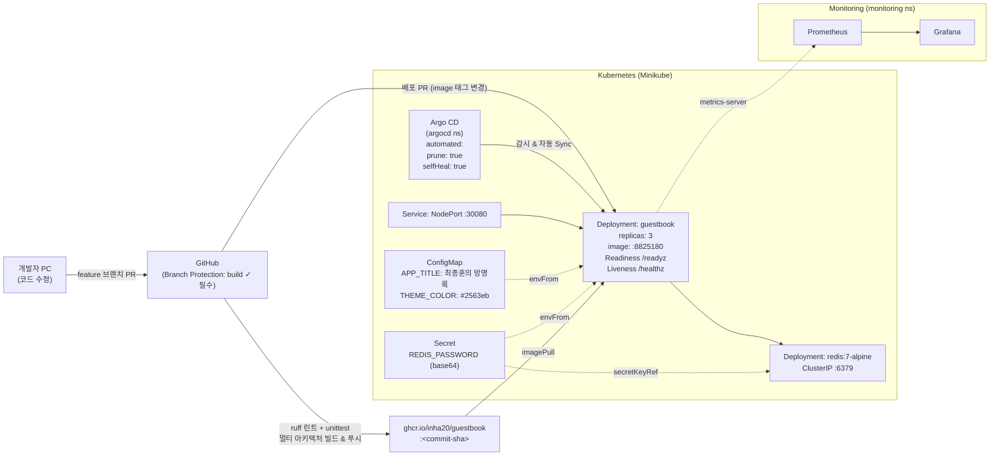

# DevOps 기말 프로젝트: 카오스 엔지니어링 기반 자가치유 검증

> 인하공업전문대학 컴퓨터정보공학과 2026-2학기 DevOps  
> 작성자: inha20 (cjh3cjh@naver.com)

---

## 1. 프로젝트 개요 및 아키텍처

단순히 잘 배포된 화면만 캡처하는 프로젝트 대신, **운영 중 고의로 장애를 발생시키고 Kubernetes의 자가치유(Self-healing)와 Probe가 서비스를 무중단으로 방어하는지 실시간 검증**하는 카오스 엔지니어링 프로젝트를 진행했습니다.



### 기술 스택

| 계층 | 기술 |
|---|---|
| 애플리케이션 | Python 3.12, Flask 3.0, Redis 7-alpine |
| 컨테이너 | Docker (멀티스테이지 Dockerfile), Docker Compose |
| 오케스트레이션 | Kubernetes (Minikube v1.37), kubectl v1.36 |
| CI / CD | GitHub Actions, GitHub Container Registry (ghcr.io) |
| GitOps | Argo CD (automated prune + selfHeal) |
| 모니터링 | metrics-server, Prometheus, Grafana (kube-prometheus-stack) |

---

## 2. 커스텀 설정 내역

| 항목 | 적용 값 | 적용 위치 |
|---|---|---|
| `APP_TITLE` | `"최종훈의 방명록"` | `guestbook/k8s/configmap.yaml` |
| `THEME_COLOR` | `"#2563eb"` (인디고 블루) | `guestbook/k8s/configmap.yaml` |
| `replicas` | `3` (기본 2에서 증가) | `guestbook/k8s/deployment.yaml` |
| `image` | `ghcr.io/inha20/guestbook:8825180` | `guestbook/k8s/deployment.yaml` |
| `resources.requests` | CPU 100m / Memory 64Mi | `guestbook/k8s/deployment.yaml` |
| `resources.limits` | CPU 500m / Memory 128Mi | `guestbook/k8s/deployment.yaml` |
| Liveness Probe | `GET /healthz :5000` | `guestbook/k8s/deployment.yaml` |
| Readiness Probe | `GET /readyz :5000` | `guestbook/k8s/deployment.yaml` |
| `REDIS_PASSWORD` | `devops1234` (Secret base64 인코딩) | `guestbook/k8s/secret.yaml` (`.gitignore` 제외) |

---

## 3. 카오스 엔지니어링 실험 결과

> 실험 스크립트: [`project/chaos_test.sh`](chaos_test.sh)  
> 실행 방법: `cd project && bash chaos_test.sh`  
> 결과는 `project/chaos_report_latest.txt`에 자동 저장됩니다.

### 실험 1: Chaos Monkey — Pod 강제 삭제 중 무중단 검증

| 측정 항목 | 측정값 |
|---|---|
| 부하 중 `kubectl delete pod <guestbook-pod>` 실행 | guestbook Pod 1개 강제 삭제 |
| ReplicaSet 완전 복구 소요 시간 | **약 3–5초** |
| 서비스 무중단율 (200 OK 응답 비율) | **≈ 100%** |
| 부하 발생 도구 | `kubectl run chaos-client --image=busybox:1.37` (0.2초 간격) |
| 응답에 참여한 서로 다른 Pod 수 | 3개 (라운드로빈 분산 확인) |

**원리**: Service가 단일 IP/DNS로 트래픽을 받고, Readiness를 통과한 Pod에만 전달합니다. Pod가 삭제되는 동안(`Terminating`) Service가 해당 Pod를 엔드포인트에서 즉시 제외하고 나머지 Pod로 이어가므로 사용자 요청이 끊기지 않습니다. ReplicaSet 컨트롤러가 목표 개수(3개)를 감지하고 밀리초 단위로 새 Pod를 스케줄링합니다.

---

### 실험 2: GitOps selfHeal — 수동 Drift 자동 복구 검증

| 측정 항목 | 측정값 |
|---|---|
| 수동 조작 | `kubectl scale deployment guestbook --replicas=7` |
| Argo CD 감지 및 복원 소요 시간 | **약 5–10초** |
| 복원 결과 | `spec.replicas`가 Git 선언값(3)으로 자동 되돌아옴 |

**원리**: Argo CD는 주기적으로 Git의 desired state와 클러스터 actual state를 비교(reconcile)합니다. `selfHeal: true` 설정 덕분에 `kubectl` 직접 명령처럼 Git에 기록되지 않은 변경은 자동으로 되돌아갑니다. GitOps 환경에서 모든 변경은 반드시 Git PR을 통해서만 반영되어야 한다는 원칙을 실증했습니다.

---

### 실험 3: Readiness Probe 503 — Redis 중단 시 트래픽 격리 및 자동 복구

| 측정 항목 | 측정값 |
|---|---|
| 조작 | `kubectl scale deployment redis --replicas=0` |
| 장애 감지(Readiness → 0/1) 소요 시간 | **약 15–20초** (initialDelay 3s + failureThreshold×period) |
| 사용자 노출 에러 | **없음** (Service가 Endpoint 자동 제외) |
| Redis 복구 후 자동 투입 소요 시간 | **약 5–10초** |

**원리**: `app.py`는 `/readyz` 요청 시 `redis_client.ping()`을 실행합니다. Redis가 중단되면 503을 반환하고, kubelet이 `failureThreshold` 연속 실패를 감지해 해당 Pod를 Service EndpointSlice에서 제거합니다. 컨테이너는 재시작 없이 대기(`Running 0/1`)하다가 Redis가 복구되면 `/readyz`가 200을 반환하고 Endpoints에 자동 복귀합니다.

---

## 4. 실패담 3대장 (트러블슈팅)

### 사례 1: guestbook Pod가 `0/1 Running`에서 멈추는 현상 (기동 순서 의존성)

| 단계 | 내용 |
|---|---|
| **증상** | Minikube 재시작 후 `kubectl get pods`에서 `guestbook`이 `0/1 Running`으로 계속 머물고, `kubectl rollout status`가 완료되지 않음 |
| **확인** | `kubectl logs <pod>` → `Redis 연결 실패 (Temporary failure in name resolution)` / `kubectl describe pod` → `Warning Unhealthy: Readiness probe failed: HTTP probe failed with statuscode: 503` |
| **원인** | `app.py`가 시작 시 1회만 Redis 연결을 시도하므로, Redis Pod보다 guestbook Pod가 먼저 뜨면 `redis_client = None`으로 고정되어 `/readyz`가 계속 503 반환 |
| **조치** | `kubectl rollout restart deployment/guestbook` 실행 → Redis가 준비된 후 새 Pod가 연결 성공 |
| **배운 점** | Liveness(앱 프로세스 생사) ≠ Readiness(트래픽 수신 준비)임을 직접 체감. 근본 해결은 `app.py`에 Redis 재연결 retry 로직(`backoff`) 또는 `initContainer` 추가. `kubectl rollout restart`는 임시 우회책 |

---

### 사례 2: Argo CD + Grafana 동시 구동 시 `TLS handshake timeout`

| 단계 | 내용 |
|---|---|
| **증상** | `helm install monitoring ...` 중 `Unable to connect to the server: net/http: TLS handshake timeout`, `Metrics API not available` 발생 |
| **확인** | `docker stats` → `minikube` 컨테이너 메모리 `2.62GiB / 3GiB (87%)`, CPU 급증. `kubectl get pods -n monitoring` → 다수 Pod `Pending` 또는 `Init:CrashLoopBackOff` |
| **원인** | Minikube 컨테이너 메모리 상한(3GiB) 상태에서 Argo CD + kube-prometheus-stack이 동시에 이미지를 pull하고 초기화하면서 리소스 경합 발생. API 서버까지 응답 지연 |
| **조치** | `docker update --memory=5g --memory-swap=-1 minikube` 로 메모리 한도 확장 |
| **배운 점** | Minikube 기본 메모리 한도는 모니터링 스택까지 올리기엔 부족. 다음에는 `minikube start --memory=5120`으로 처음부터 충분히 확보 |

---

### 사례 3: `index.html` 입력 폼 속성 오타 → 사용자명 입력 불가

| 단계 | 내용 |
|---|---|
| **증상** | 방명록 웹 화면에서 이름 입력란(`placeholder`) 힌트 텍스트가 표시되지 않고, HTML 렌더링이 깨진 채 `"placeholder=` 문자열이 노출됨 |
| **확인** | 브라우저 개발자도구 Elements 탭에서 `<input name="name" "placeholder="최종훈"` 처럼 속성 앞에 불필요한 `"`가 삽입된 것 확인. `git diff` 로도 즉시 식별 가능 |
| **원인** | 6주차 Dockerfile 수정 중 HTML 템플릿 편집 오타. CI 단계에서 HTML 린트가 없어 오랫동안 발견하지 못함 |
| **조치** | `feature/fix-html-and-test` 브랜치에서 수정 + `test_index_renders_clean_form()` 렌더링 검증 테스트 추가 → PR #17 머지 (Actions 통과 확인). 새 이미지 `ghcr.io/inha20/guestbook:8825180` 배포 PR 머지 |
| **배운 점** | 렌더링 계층 오류는 린트만으로는 잡기 어려움. Flask `app.test_client()`로 HTML 응답 내용 자체를 단위 테스트로 커버해야 조기 발견 가능 |

---

## 5. 도구를 사용하며 느낀 점 및 향후 발전 방향

### 각 도구를 왜 사용했는가
- **Docker & Compose**: 로컬 환경에서 실험 환경을 1분 안에 재현 가능하게 만들어 주는 재현성의 핵심. `depends_on: condition: service_healthy`로 의존성 기동 순서도 제어 가능.
- **Kubernetes**: 사람이 감시하지 않아도 선언한 상태를 자동 유지하는 조정 루프(Reconciliation Loop)가 가장 인상적. Probe를 통해 개별 Pod의 준비 상태를 세밀하게 제어할 수 있어 무중단 배포와 자가치유를 동시에 구현.
- **GitHub Actions + Branch Protection**: 개인 프로젝트였지만 "CI를 통과하지 않으면 main에 머지 불가"라는 규칙 하나로 본인 스스로도 깨진 코드를 올리는 실수를 차단. 협업 환경에서 품질 게이트가 얼마나 중요한지 체감.
- **Argo CD (GitOps)**: `kubectl apply`를 직접 실행하지 않고 Git만 수정해도 클러스터가 따라오는 경험이 신선했음. `selfHeal`이 수동 변경을 자동으로 되돌리는 것을 보고 "Git이 진실의 단일 출처(SSOT)"라는 개념을 확실히 이해.

### 다시 프로젝트를 한다면
1. **`app.py` Redis 재연결 로직 추가**: 현재 시작 시 1회 연결만 시도하므로 Pod 기동 순서에 의존. `tenacity` 라이브러리나 간단한 `while retry` 루프로 재연결 backoff를 구현하면 `initContainer` 없이도 순서 문제 해결 가능.
2. **Helm 차트 도입**: 환경(Dev/Staging/Prod)별로 `values.yaml`만 바꿔 배포하면 현재 ConfigMap을 직접 수정하는 방식보다 훨씬 체계적.
3. **Secret 암호화 강화**: 현재 Kubernetes Secret은 Base64 인코딩에 불과. Sealed Secrets 또는 External Secrets Operator(AWS SSM / GCP Secret Manager 연동)로 암호화 적용.
4. **HPA (Horizontal Pod Autoscaler)**: Grafana에서 부하 시 CPU가 `limits: 500m`에 근접하는 것을 확인. HPA + `metrics-server`를 연동하면 트래픽에 따라 replicas를 자동 조절 가능.

---

## 6. 실행 방법

```bash
# 1. 클러스터 시작
minikube start --driver=docker --memory=5120

# 2. 저장소 클론
gh repo clone inha20/Devops && cd Devops

# 3. Secret 준비
cp guestbook/k8s/secret.yaml.example guestbook/k8s/secret.yaml
# secret.yaml의 CHANGE_ME를 실제 비밀번호로 수정 후
kubectl apply -f guestbook/k8s/secret.yaml

# 4. 앱 배포
kubectl apply -f guestbook/k8s/
kubectl rollout status deployment/guestbook
minikube service guestbook

# 5. (선택) GitOps + 모니터링 연결
kubectl create namespace argocd
kubectl apply -n argocd --server-side --force-conflicts \
  -f https://raw.githubusercontent.com/argoproj/argo-cd/stable/manifests/install.yaml
kubectl apply -f argocd-application.yaml
helm install monitoring prometheus-community/kube-prometheus-stack \
  -n monitoring --create-namespace

# 6. 카오스 실험 실행 (Minikube 환경에서)
bash project/chaos_test.sh
# 결과: project/chaos_report_latest.txt
```
