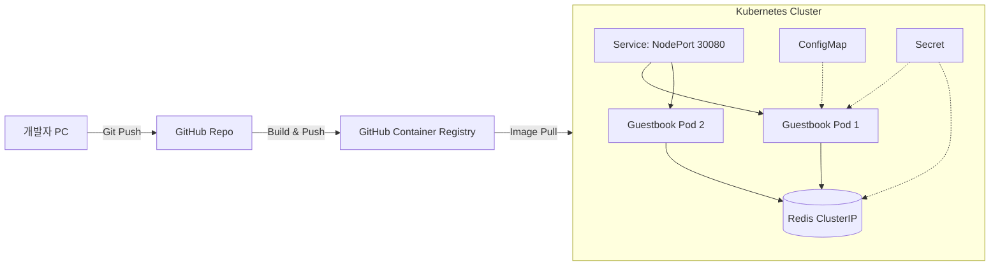

# DevOps 기말 프로젝트: 방명록 CI/CD 파이프라인 완주 및 회고

## 1. 프로젝트 개요
- **프로젝트 명**: DevOps 컨테이너 기반 방명록 서비스 구축 및 쿠버네티스 오케스트레이션
- **작성자**: 인하공업전문대학 컴퓨터정보공학과 (inha20)
- **프로젝트 목적**:
  - 단순 수동 배포에서 벗어나 컨테이너 가상화, 선언형 인프라(IaC), 고가용성 서비스 배포 및 상태 점검을 포함한 전체 DevOps 파이프라인을 구축하고 그 과정을 완주하여 기록합니다.

---

## 2. 전체 아키텍처 및 파이프라인 구성

1. **컨테이너화**: Flask 기반 무상태(Stateless) 웹 애플리케이션 및 Redis 세션/방명록 데이터베이스
2. **패키징 & 레지스트리**: GitHub Container Registry (ghcr.io)
3. **오케스트레이션**: Kubernetes (Deployment, Service, ConfigMap, Secret, Probes)
4. **무중단 운영**: Rolling Update, Readiness/Liveness Probe 기반 자가치유 및 트래픽 격리

---

## 3. 커스텀 설정 및 구현 내역
- **애플리케이션 타이틀 (`APP_TITLE`)**: 본인 커스텀 타이틀 적용
- **테마 컬러 (`THEME_COLOR`)**: ConfigMap을 통한 동적 변경
- **복제본 개수 (`replicas`)**: 다중 Pod 부하 분산 및 로드밸런싱 검증
- **자원 제한 (`resources`)**: Requests (CPU 100m, Memory 64Mi) / Limits (CPU 500m, Memory 128Mi)
- **헬스체크 (`probes`)**:
  - Liveness: `/healthz` (앱 프로세스 생존 확인)
  - Readiness: `/readyz` (Redis 의존성 검증 및 준비 상태 확인)

---

## 4. 트러블슈팅 및 실패담 공유 (Failures & Solutions)

### 사례 1: Secret/ConfigMap 주입 후 Pod 미기동 (`CreateContainerConfigError`)
- **증상**: Pod 생성 후 상태가 `CreateContainerConfigError`로 유지됨
- **확인**: `kubectl describe pod <pod-name>`의 Events에서 `Error: configmap "guestbook-config" not found` 확인
- **원인**: YAML 파일 내 `configMapRef.name`의 오타
- **조치**: 매니페스트 이름 일치 수정 후 `kubectl apply -f k8s/deployment.yaml` 재적용
- **결과**: Pod가 즉시 `Running` 상태로 정상 진입

### 사례 2: Redis 연결 두절 시 무중단 트래픽 차단 (`Readiness Probe`)
- **증상**: Redis 장애 시 사용자가 500 에러 화면을 마주하는 문제
- **확인**: `kubectl describe svc guestbook`에서 Endpoints가 모두 해제됨을 확인
- **원인**: DB가 비정상일 때 앱이 요청을 받지 않도록 `/readyz`가 503을 반환함
- **조치**: Service 수준에서 사용자 요청을 차단하여 불완전한 처리를 방지, Redis 복구 시 즉시 자동 투입
- **결과**: 사용자 데이터 정합성 보장 및 무장애 복구 달성

---

## 5. 도구를 사용하며 느낀 점 및 향후 개선 방향
- **도커 및 컴포즈**: 단일 서버 환경에서 신속한 테스트와 재현성을 보장하는 데 매우 유용했음.
- **쿠버네티스**: 선언형 접근 방식(Declarative)의 강력함을 체험. 사람이 일일이 감시하지 않아도 시스템이 스스로 원하는 상태를 맞춰가는 조정 루프가 인상적이었음.
- **다시 프로젝트를 진행한다면**:
  - 비밀 관리 시 평문 노출 위험이 있는 기본 Secret 대신 HashiCorp Vault나 Sealed Secrets를 도입하고 싶음.
  - Helm 차트를 작성하여 환경(Dev, Stage, Prod)별 설정을 더욱 체계적으로 템플릿화할 계획임.
